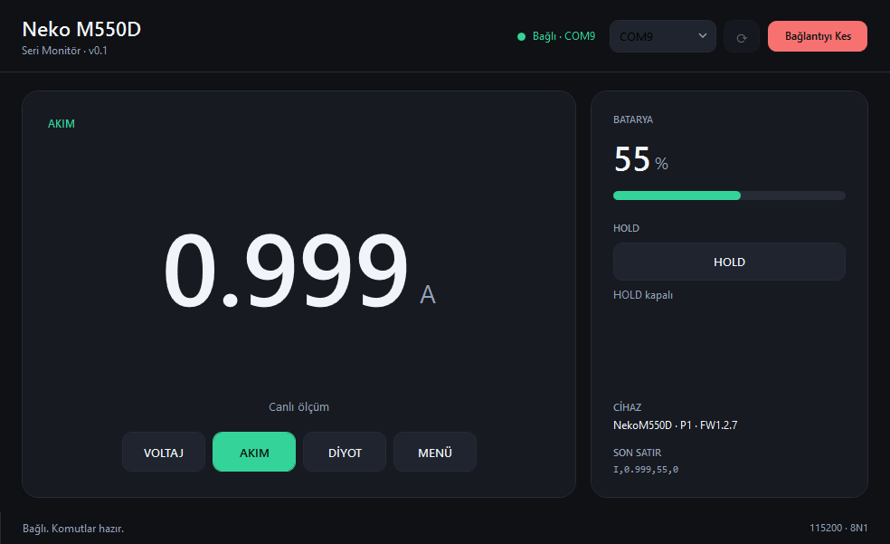

# Neko M550D

> **AI BULLSHIT SLOP WARNING**
>
> The firmware and PC application in this repository were generated **entirely by AI, with no human coding effort**. This is an AI slop device; do not take it seriously. Hardware design, calibration, and field testing were done by the author. Do not use it for serious, commercial, or safety-critical measurements.

Neko M550D is a DIY bench multimeter built around an Arduino Uno. It measures DC voltage, current, and diode forward voltage, displays readings on a 16x2 I2C LCD, and exposes a small serial protocol for a PC monitor.

The voltage and diode measurements share a single probe input. A fifth relay, controlled from D10, selects the path: **NC = voltage path**, **NO = diode path**.

## Screenshot



## Features

- 4-stage autoranging voltage measurement (nominal 5 / 10 / 25 / 50 V ranges)
- Current measurement up to 5.5 A (`OL` above that), 0.05 Ω shunt
- Diode forward-voltage measurement with a 1 mA current source
- 3S Li-ion battery monitor with percentage-based charge detection
- 16x2 LCD (PCF8574 at 0x27), three buttons, passive buzzer
- HOLD mode, charging warning screen, low-battery warning
- 115200 baud serial protocol and a C# WPF PC monitor
- Startup VCC calibration against a TL431 2.5 V reference

## Hardware

| Function | Pin |
|---|---|
| PREV / NEXT / SELECT buttons | D8 / D7 / D6 |
| Buzzer | D9 |
| Relays R1–R4 | D5, D4, D3, D2 |
| Shared probe relay R5 | D10 |
| Voltage sense | A0 |
| Current sense | A1 |
| Diode sense | A2 |
| Battery divider | A3 |
| LCD PCF8574 | I2C, address 0x27 (A4/A5 on Uno) |
| Serial (PC) | D0/D1, 115200 8N1 |

**Schematic and project page:** [ekremelectronics.com/projeler/arduino-multimetre.html](https://ekremelectronics.com/projeler/arduino-multimetre.html)

## Repository layout

```
NekoM550D/
├─ firmware/
│  ├─ NekoM550D/           # main firmware
│  └─ kalibrasyon/         # calibration helper sketch
├─ pc/
│  └─ NekoM550D.Monitor/   # C# / WPF PC monitor
├─ docs/
│  ├─ SERIAL_PROTOCOL.md
│  └─ images/
└─ README.md
```

## Firmware

Open `firmware/NekoM550D/NekoM550D.ino` in the Arduino IDE. The folder and `.ino` file names must match.

With `arduino-cli`:

```bash
arduino-cli compile --fqbn arduino:avr:uno firmware/NekoM550D
arduino-cli upload -p COM9 --fqbn arduino:avr:uno firmware/NekoM550D
```

- `firmware/kalibrasyon/kalibrasyon.ino` is a separate calibration helper sketch.
- Firmware version: **v1.2.7**.

## PC monitor

Requirements: Windows 10/11 and the .NET 8 SDK (for building).

```bash
cd pc/NekoM550D.Monitor
dotnet run -c Release
```

Single-file publish (self-contained, about 155 MB):

```bash
dotnet publish -c Release -r win-x64 --self-contained true \
  -p:PublishSingleFile=true \
  -p:IncludeNativeLibrariesForSelfExtract=true \
  -p:DebugType=None -p:DebugSymbols=false -o publish
```

The published binary is **not** committed to this repository.

Usage:

1. Close Arduino IDE / Serial Monitor (they lock the port).
2. Select the COM port and click **Bağlan** (Connect).
3. The Arduino resets when the port opens; the first data arrives after about 3–4 seconds.
4. Use **VOLTAJ / AKIM / DİYOT / MENÜ** to change modes and **HOLD** to freeze the reading.

## Serial protocol

115200 8N1, newline-terminated ASCII.

- Device → PC, about every 250 ms: `MODE,VALUE,BATTERY,HOLD`
  - `V,12.34,85,0`
  - `I,1.000,84,1`
  - `D,0.652,84,0`
  - `M,-,85,0`
  - `OL` means open circuit / out of range.
- PC → device: `V`, `I`, `D`, `M`, `H`, `?`, and `#` for device identity.

Full details: [docs/SERIAL_PROTOCOL.md](docs/SERIAL_PROTOCOL.md)

## Calibration and limitations

- VCC is calibrated at every boot against the TL431 2.5 V reference.
- Voltage and current scale factors are calibrated constants in the firmware (`VFACT`, `IFACT`, `I_BIAS_RAW`); they are not stored in EEPROM.
- Diode mode has not been calibrated.
- No EEPROM-backed settings.
- The 3S Li-ion BMS cuts off at about 10.1 V; the battery curve is matched to the pack.
- This is a hobby/lab prototype. It is not a certified instrument and must not be used for safety-critical measurements.

## License

No license is provided. **All rights reserved.** You may not copy, modify, or redistribute this project without permission.

## AI disclosure and credits

- Firmware and PC application: generated by AI, with no human coding effort. AI slop.
- Hardware design, calibration, measurements, and field testing: Ekrem.
- Project page and schematic: [ekremelectronics.com/projeler/arduino-multimetre.html](https://ekremelectronics.com/projeler/arduino-multimetre.html)
- Source-code comments are in Turkish; documentation is in English.
